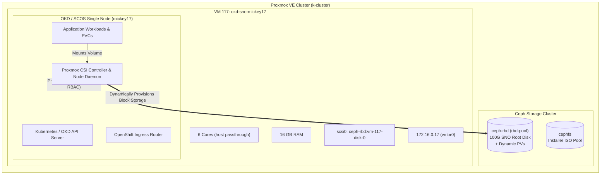

# OKD Single Node OpenShift (SNO / AIO) Installer: mickey17

Automated deployment toolkit for **OKD Single Node OpenShift (SNO / All-in-One PoC)** on **Proxmox VE** backed by **Ceph Storage** and integrated with the **Proxmox CSI Plugin**.

---

## 1. Overview & Architecture

This repository automates the installation and lifecycle of an OKD SNO cluster named **`mickey17`** running in the homelab engineering cluster (`k-cluster`).

- **Cluster Name**: `mickey17`
- **Base Domain**: `engineering.lan`
- **FQDN**: `mickey17.engineering.lan`
- **Topology**: All-in-One Single Node (Control plane + compute workloads colocated on one node)
- **Target Hypervisor**: Proxmox VE 9 (`k1.engineering.lan` - `172.16.0.10`)
- **Primary Storage**: Ceph Block Storage (`ceph-rbd` pool `rbd-pool`) for VM root disk and dynamically provisioned Persistent Volumes
- **Shared Storage**: CephFS (`cephfs`) for bootable installer ISOs and RWX volumes
- **CSI Driver**: [Proxmox CSI Plugin (`csi.proxmox.sinextra.dev`)](https://github.com/sergelogvinov/proxmox-csi-plugin)



---

## 2. Cluster Specifications

| Parameter | Value | Description |
|:---|:---|:---|
| **Cluster Name** | `mickey17` | OpenShift cluster identifier |
| **Base Domain** | `engineering.lan` | DNS base domain |
| **API Endpoint** | `https://api.mickey17.engineering.lan:6443` | Kubernetes / OKD API |
| **Web Console** | `https://console-openshift-console.apps.mickey17.engineering.lan` | OpenShift Web GUI |
| **VMID** | `117` | Proxmox QEMU VM identifier |
| **vCPUs** | `6` cores (`host` CPU type) | Passthrough host CPU features |
| **Memory** | `16384 MB` (16 GB) | Dedicated RAM for Single Node PoC |
| **Root Disk** | `100 GB` on `ceph-rbd` | Backed by Ceph OSDs |
| **Network IP** | `172.16.0.17/24` | Static IP on `vmbr0` |
| **Gateway / DNS** | `172.16.0.1` / `10.0.0.1` | Network routing and upstream DNS |
| **Default StorageClass** | `proxmox-csi-ceph-rbd` | Dynamic volume provisioning on Ceph |

---

## 3. Repository Structure

```
okd-mickey17/
├── Makefile                          # Unified CLI entrypoint
├── README.md                         # Architecture and runbook documentation
├── install-config.yaml               # OKD SNO install-config manifest
├── agent-config.yaml                 # Agent-based installer network & host hints
├── env.sh.example                    # Template environment variables
├── env.sh                            # Local cluster configuration
├── .gitignore                        # Git exclusion rules
├── pve-csi/
│   ├── config.yaml.example           # Proxmox CSI token configuration template
│   ├── storageclass-ceph-rbd.yaml    # Default StorageClass on Ceph RBD
│   ├── storageclass-cephfs.yaml      # StorageClass for shared CephFS
│   ├── test-pvc.yaml                 # Dynamic PVC verification manifest
│   └── test-pod.yaml                 # Volume test pod
├── scripts/
│   ├── 00-install-tools.sh           # Downloads openshift-install and oc CLI
│   ├── 01-prep-proxmox-ceph.sh       # Configures Proxmox CSI role, user & token
│   ├── 02-generate-iso.sh            # Generates Agent ISO with embedded ignition
│   ├── 03-create-vm-ceph.sh          # Provisions VM 117 on Proxmox Ceph RBD
│   ├── 04-wait-for-install.sh        # Monitors install & approves pending CSRs
│   ├── 05-deploy-proxmox-csi.sh      # Deploys Proxmox CSI plugin & StorageClasses
│   ├── 06-test-ceph-storage.sh       # Runs end-to-end dynamic PVC verification
│   └── destroy-vm.sh                 # Gracefully tears down VM 117
└── dns/
    ├── hosts.example                 # Static /etc/hosts resolution
    └── Corefile.example              # Wildcard CoreDNS sample
```

---

## 4. Quickstart: One-Command Deployment

To deploy the entire PoC cluster end-to-end:

```bash
# 1. Clone repository
git clone https://github.com/adynetro/okd-mickey17.git
cd okd-mickey17

# 2. Review or customize environment
cp env.sh.example env.sh

# 3. Launch automated deployment
make deploy
```

---

## 5. Step-by-Step Execution Guide

### Step 1: Install Dependencies & Tools
Download `openshift-install` and `oc` CLI if not already present in PATH:
```bash
make tools
```

### Step 2: Prepare Proxmox VE & Ceph RBAC
Configures the Proxmox CSI role, creates the service user `kubernetes-csi@pve`, generates the API token, and writes `pve-csi/config.yaml`:
```bash
make prep
```

### Step 3: Build Agent Installer ISO
Generates the bootable Agent Installer ISO and uploads it directly to Proxmox CephFS (`cephfs:iso/agent-mickey17.iso`):
```bash
make iso
```

### Step 4: Create VM on Ceph Storage
Allocates VM 117 on `k1`, provisions its 100GB root disk directly on the Ceph RBD pool (`ceph-rbd:vm-117-disk-0`), attaches the ISO, and boots the node:
```bash
make vm
```

### Step 5: Wait for Installation Complete
Monitors cluster bootstrapping, approves CSR certificates, and enables the internal OpenShift registry:
```bash
make wait
```

### Step 6: Deploy Proxmox CSI Driver
Deploys the Proxmox CSI plugin, grants Privileged SCC, and installs StorageClasses for Ceph:
```bash
make csi
```

### Step 7: Verify Dynamic Persistent Storage on Ceph
Deploys a test PVC on `proxmox-csi-ceph-rbd` and verifies that Proxmox automatically allocates a Ceph RBD image:
```bash
make test
```

---

## 6. Proxmox CSI Configuration Details

The CSI driver runs inside the cluster under namespace `csi-proxmox` and communicates with the Proxmox VE API using token authentication:

```yaml
# pve-csi/storageclass-ceph-rbd.yaml
apiVersion: storage.k8s.io/v1
kind: StorageClass
metadata:
  name: proxmox-csi-ceph-rbd
  annotations:
    storageclass.kubernetes.io/is-default-class: "true"
provisioner: csi.proxmox.sinextra.dev
parameters:
  storage: ceph-rbd
reclaimPolicy: Delete
allowVolumeExpansion: true
volumeBindingMode: Immediate
```

### Proxmox Permissions Granted:
- **Role**: `CSI`
- **Privileges**: `Datastore.Allocate`, `Datastore.AllocateSpace`, `Datastore.Audit`, `VM.Audit`, `VM.Config.Disk`
- **User**: `kubernetes-csi@pve`
- **Token**: `kubernetes-csi@pve!csi`
- **Scope**: `/`

---

## 7. DNS Resolution Setup

Add the following records to your local `/etc/hosts` or upstream DNS server:

```text
172.16.0.17 api.mickey17.engineering.lan
172.16.0.17 api-int.mickey17.engineering.lan
172.16.0.17 mickey17.engineering.lan
172.16.0.17 console-openshift-console.apps.mickey17.engineering.lan
172.16.0.17 oauth-openshift.apps.mickey17.engineering.lan
172.16.0.17 canary-openshift-ingress-canary.apps.mickey17.engineering.lan
```

---

## 8. Teardown / Cleanup

To tear down the PoC VM and purge all allocated disks on Ceph RBD:

```bash
make destroy
```

---

## 9. License

MIT License. Designed for Homelab & Enterprise Kubernetes evaluation.
